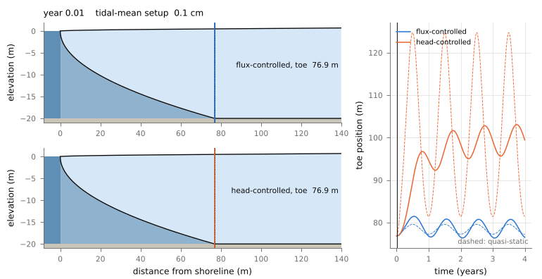
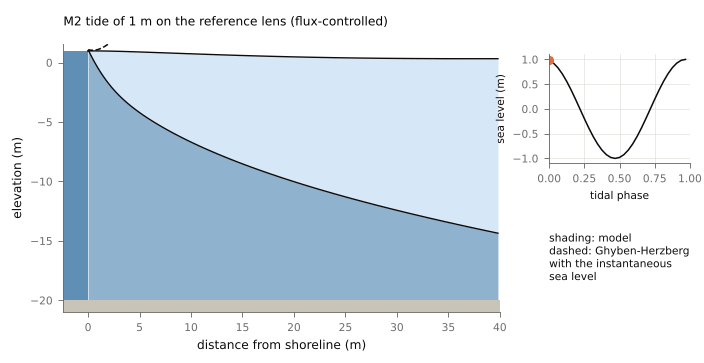

# Supplementary Materials "Tides, wave setup, and the freshwater-saltwater interface of an idealized coastal aquifer"

[](https://doi.org/10.5281/zenodo.23766553)
[](https://www.python.org)
[](https://numpy.org)
[](https://scipy.org)
[](https://peps.python.org/pep-0008/)
[](LICENSE)

Supplementary code for an idealized two-layer model of an unconfined coastal aquifer, in which a sharp interface separates fresh groundwater from seawater and the shoreline sea level carries a tide and a wave setup. The interface barely follows the tide, rectifies it into a millimeter-scale rise of the saltwater head, and responds to the slow part of the wave setup with a lag of months. No field data are used.

**Authors:** Dasapta E. Irawan, Sandy H. S. Herho

[](outputs/animations/anim02_season.gif)
Tidal-mean freshwater lens (light) over seawater (dark) under four years of wave setup (0.2 m mean, 0.15 m annual amplitude) with an M2 tide of 0.5 m, for a flux-controlled aquifer (top) and a head-controlled aquifer (bottom). Colored lines mark the toe, the dotted line its untided position. Right: toe position against time, with the quasi-static Strack-Glover toe dashed.

| [](outputs/animations/anim01_tide.gif) |
|:--:|
| Two cycles of a 1 m M2 tide at the shoreline end of the lens. Shading is the model; the dashed line is the Ghyben-Herzberg interface computed with the instantaneous sea level. |

## Model

Under the Dupuit assumption each layer is hydrostatic. With water table $h$, interface $\zeta$, base at $z=-B$, density contrast $\delta=(\rho_s-\rho_f)/\rho_f$, conductivity $K$ and porosity $n$, the two volume balances are

$$n\,\partial_t(h-\zeta)=\partial_x\!\left[K(h-\zeta)\,\partial_x h\right]+R,\qquad n\,\partial_t\zeta=\partial_x\!\left[K(\zeta+B)\,\partial_x(h+\delta\zeta)\right],$$

where $h+\delta\zeta=(1+\delta)\phi$ is the saltwater head written as a freshwater potential. Pressure continuity gives $\zeta=[(1+\delta)\phi-h]/\delta$, which reduces to the Ghyben-Herzberg rule only when the saltwater head equals the sea level. At a beach face both unknowns equal the sea level $\eta(t)=\bar\eta_w(t)+A\cos\omega t$, so the lens pinches out at the shoreline; inland the freshwater discharge $Q$ (flux control) or the freshwater head (head control) is fixed and the saltwater is closed.

Linearizing about uniform layers $H_f$, $H_s$ ($H=H_f+H_s$) decouples two diffusive modes with exact diffusivities

$$D_{0,1}=\tfrac{T}{2}\pm\sqrt{\tfrac{T^2}{4}-\tfrac{K^2}{n^2}\,\delta H_fH_s},\qquad T=\tfrac{K}{n}(H+\delta H_s),$$

a barotropic mode $D_0\approx KH/n$ that carries the water table and a baroclinic (interface) mode $D_1\approx\delta KH_fH_s/(nH)$, the porous-medium counterpart of the reduced-gravity speed of two-layer flow, with $D_1/D_0\le\delta/4$.

The finite-volume scheme is cell-centered on a grid graded from 5 cm at the shore to 1 m, with arithmetic-mean layer thicknesses at faces. For a lens with saltwater at rest the steady face flux is then the exact difference of the Kirchhoff potential $K(1+\delta)(h-\eta)^2/2\delta$, so the discrete steady lens reproduces the Strack-Glover solution to round-off. Where a layer vanishes (the shoreline pinch-out, the toe) the face thickness is capped at twice the upstream thickness, which keeps both layers non-negative and is inactive in smooth regions. Time stepping is TR-BDF2 (second order, L-stable) with a banded Newton solver, and the boundary exchange is summed with the TR-BDF2 weights so that the volume budget closes to the Newton tolerance.

## Key results

**The interface ignores the tide.** In the lens the interface oscillation stays of the order of the tidal amplitude (at most $1.6A$, within a meter of the shore) and decays faster than the water table, while the Ghyben-Herzberg rule applied to the instantaneous sea level predicts swings up to $29A$. Away from the shore the interface follows the water table with a ratio of order $H_s/H$ and a lag of 11 to 30 degrees.

**The tide rectifies into an exact second-order mean.** For fields built from the two modes with real modal amplitudes, as a tidal sea level produces, the period-averaged flux integrals satisfy $\int_0^\infty\langle f\,\partial_xg\rangle\,dx=-\tfrac14 f(0)g(0)-\tfrac14\rho\,W(f,g)$, with $\rho=(D_0-D_1)/(D_0+D_1)$ and $W$ the modal Wronskian, independent of frequency. This gives, for uniform layers,

$$\bar h_\infty=\frac{A^2}{4(H+\delta H_s)},\qquad \bar\zeta_\infty=\bar h_\infty+\frac{A^2}{4H_s},$$

independent of $K$, $n$ and $\omega$: the tide raises the water table less than the classical freshwater overheight $A^2/4H_f$ and thins the freshwater layer by $A^2/4H_s$. In the thin-lens limit the saltwater head rises by $A^2/4B$.

**In the lens the tide acts like millimeters of sea-level rise.** Outside the tidal layer the mean lens is a Strack-Glover lens with a raised saltwater head $\phi_e$ and a landward-shifted shoreline $s$. The fitted closure $\phi_e=c_\phi A^2/4B$, $s=c_sA^2$ reproduces the tidal toe shifts of both control types within 5 percent.

| reference aquifer: K = 30 m/d, n = 0.3, B = 20 m, Q = 2 m²/d, toe at 76.9 m | value |
|:--|:--|
| $c_\phi$ (thin-lens theory: 1) / $c_s$ | 1.069 / 0.289 m⁻¹ |
| toe shift from a 1 m M2 tide, flux / head control | 0.39 m / 1.39 m |
| toe shift from 0.1 m of mean setup, flux / head control | 0.77 m / 9.66 m |
| mean setup that moves the toe as far as a 1 m tide, flux / head | 5.1 cm / 1.6 cm |
| interface decay length $L_1$ at M2 / spring-neap / annual ($H_f=H_s=10$ m) | 1.4 m / 7.6 m / 38 m |
| toe excursion per meter of annual setup, flux / head (quasi-static 7.7 / 86.5) | 14.9 m / 27.6 m |
| toe lag behind an annual setup cycle, flux / head | 21 d / 79 d |
| seasonal run, last year: toe range flux / head (quasi-static 2.3 / 43.3 m) | 4.4 m / 7.4 m |

**The interface low-passes the wave setup.** Short setup cycles move the toe alike under both controls, because the inland boundary is not felt. The head-controlled toe approaches its large quasi-static gain only for periods of several years, so a monsoon cycle moves it by about a third of the quasi-static estimate, with a lag of about 80 days. The flux-controlled toe moves up to twice its quasi-static gain at periods of one to two years, the frequency-domain form of the overshoot known from step changes, and leads the setup at longer periods. Adding a 0.5 m tide shifts these series landward by about 0.1 m (flux control) and 0.5 m (head control), small next to the setup response.

## Verification

| check | result |
|:--|:--|
| spatial order, steady manufactured solution, graded grid | 2.00 (h), 1.98 (ζ) |
| temporal order, TR-BDF2, periodic manufactured solution | 2.00 |
| discrete steady lens vs Strack-Glover toe, flux control, Q = 1, 2, 3 m²/d and setups 0 to 0.5 m | ≤ 1.3e-13 m |
| same, head control | ≤ 1.4e-4 m |
| linear tidal response vs exact two-mode solution, periods 0.25 to 60 d | ≤ 5.7e-4 A |
| rectified means vs exact second-order theory, A = 0.05 to 0.4 m | ≤ 3.6e-4 (h), ≤ 1.0e-2 (ζ) relative |
| volume budget of every tidal lens run, 1000 days | ≤ 9e-8 m² |
| effective boundary with grid halved / 64 steps per tide | c_φ to 3e-4, toe shift to 3e-4 m |
| Newton step halvings in all reported runs | 0 |

Full tables are in `outputs/reports/verification.txt`.

## Run

```
pip install -r requirements.txt
python scripts/run_all.py
```

About 1.5 hours on two cores. Simulations cache to `outputs/cache/` and are skipped on reruns.

## Layout

```
coastal_interface/  scenario, core, linear, solver, manufactured,
                    verification, experiments, plotting, anim, io_utils
scripts/            precompute, fig00-fig08, anim01-anim02,
                    make_reports, run_all
outputs/            figures (PDF, 600 dpi PNG), animations (GIF),
                    data (CSV per panel), reports (plain text)
```

## Limitations

The parameter values are illustrative ranges for clean sands, not measurements of any site, and `outputs/reports/sensitivity.txt` shows how the effective boundary depends on them. The interface is sharp, so mixing, the upper saline plume and density-driven circulation are absent; the beach face is vertical, without seepage face, slope or wave run-up infiltration; viscosities are equal and the specific yield equals the porosity swept by the interface. The Dupuit assumption fails within a few aquifer thicknesses of the shore, which contains the tidal interface layer ($L_1$ of order 1 m at M2), so tidal-band results there are qualitative; the mean results rest on the far-field lens, about four times longer than it is thick. The closure coefficients are fitted for $A\le1$ m and the shoreline shift $s$ has no theory here. What is taken from earlier work and what is new is set out in `outputs/reports/open_items.txt`.

## Acknowledgments

This work was supported by the Faculty of Earth Sciences and Technology (FITB), Bandung Institute of Technology (ITB), through the PPMI Research Program 2026 (Project ID FITB.PPMI-1-19-2026).

## License

MIT, © 2026 Dasapta Erwin Irawan, Sandy Hardian Susanto Herho, Applied Geology Research Group, Institut Teknologi Bandung. See [LICENSE](LICENSE).
